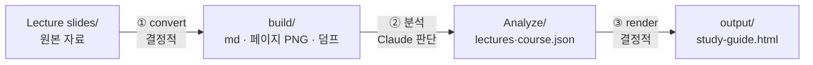

# 📚 Exam Study Guide — 위키 홈

수업 자료(.hwp/.ppt/.pptx/.xlsx/.pdf)를 **시험 직전용 단일 HTML 학습 가이드**로 바꾸는 도구의 전체 구조 위키.

> **이 위키 읽는 법** — 각 페이지는 한 가지 **책임(폴더)** 을 다루고, 머리말의 `홈`과 꼬리말의 `관련 문서`로 이동한다. 표의 모듈명은 실제 소스 파일로 연결되니(클릭) 코드와 문서를 오가며 본다. 처음이면 [아키텍처](architecture.md)부터.

---

## 한눈에 — 3단계 파이프라인



| 단계 | 주체 | 입력 → 출력 | 문서 |
|---|---|---|---|
| ① 변환·추출 | 코드(결정적) | `Lecture slides/` → `build/` | [convert](convert.md) · [extract](extract.md) |
| ② 분석 | **Claude(판단)** | `build/` → `Analyze/*.json` | [schema](schema.md) (검증 규칙) |
| ③ 렌더 | 코드(결정적) | `Analyze/*.json` → `output/study-guide.html` | [render](render.md) |

②만 사람/LLM 판단이고 ①③은 스크립트가 자동. 자세한 워크플로는 [exam-guide 스킬](../../.claude/skills/exam-guide/SKILL.md).

---

## 책임 영역 (src/ 폴더 = 위키 페이지)

| 영역 | 책임 | 페이지 |
|---|---|---|
| `config/` | 경로·디렉터리·DPI 설정 한 곳 | [config](config.md) |
| `extract/` | 포맷별 추출기 (pdf·xlsx·hwp) | [extract](extract.md) |
| `convert/` | 자료 → build 변환 파이프라인 | [convert](convert.md) |
| `schema/` | 분석 JSON 검증 | [schema](schema.md) |
| `render/` | 분석 JSON → HTML 생성 | [render](render.md) |

전체 트리·데이터 흐름·SOLID 적용은 → **[아키텍처](architecture.md)**

---

## 빠른 실행

```bash
npm install                  # 의존성(fflate, cfb, pdfjs-dist)
pip install -r requirements.txt   # pymupdf4llm (선택, 그림 판독용)

# 자료를 Lecture slides/ 에 넣고:
npm run convert   # ① → build/
#  ② Claude가 build/ 읽고 Analyze/*.json 작성
npm run validate  # ②결과 스키마 점검 (exit 0 확인)
npm run render    # ③ → output/study-guide.html
npm test          # 순수 함수 회귀 (node:test)
```

엔트리포인트 3개는 [scripts/](../../scripts/)에 있는 얇은 조립 파일이고, 로직은 전부 `src/`에 있다.

## 관련 문서
- [아키텍처](architecture.md) — 트리·데이터 흐름·SOLID
- [exam-guide 스킬 정의](../../.claude/skills/exam-guide/SKILL.md)
- [강의 JSON 스키마](../../schema/lecture.schema.md)
