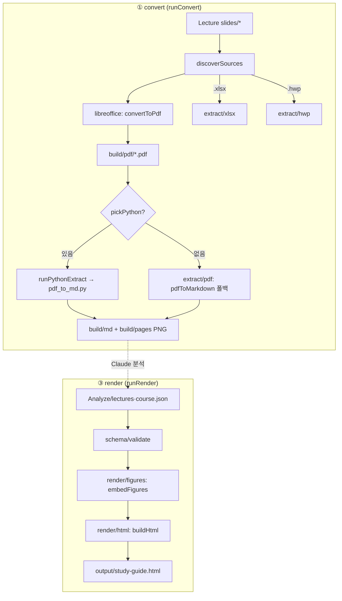

[홈](README.md) · **아키텍처**

# 아키텍처

전체 폴더 구조, 런타임 데이터 흐름, SOLID 적용을 한 곳에 모은다.

## 폴더 트리

```
scripts/                  얇은 CLI entrypoint (조립만, 각 3~5줄)
  convert.mjs · render.mjs · validate.mjs
  pdf_to_md.py            Python 추출기 (서브프로세스로 호출)

src/
  config/
    paths.mjs             경로·디렉터리·DPI 설정 한 곳
  extract/                포맷별 추출기 (한 포맷 = 한 책임)
    pdf.mjs · xlsx.mjs · hwp.mjs
  convert/                자료 → build 변환 파이프라인
    sources.mjs           소스 탐색·확장자 필터
    libreoffice.mjs       soffice 탐색·인자·변환 실행
    python.mjs            python 탐색·인자·추출 실행
    artifacts.mjs         산출물 경로 규칙·검증 (순수)
    pipeline.mjs          오케스트레이션 runConvert
  schema/
    validate.mjs          검증 규칙 (순수)
    check.mjs             검증 실행 runValidate
  render/
    html.mjs              HTML 생성 (순수)
    figures.mjs           그림 임베드 (I/O)
    pipeline.mjs          오케스트레이션 runRender

templates/guide.css       렌더 결과에 인라인되는 스타일
schema/lecture.schema.md  강의/과목 JSON 포맷 정의(사람용)
docs/wiki/                이 위키
```

작업 산출물(`build/`, `Analyze/`, `output/`, `Lecture slides/`)은 `.gitignore` 대상 — 코드가 아니라 데이터.

## 런타임 데이터 흐름



각 단계 상세: [convert](convert.md) · [extract](extract.md) · [schema](schema.md) · [render](render.md). 경로 상수는 [config](config.md).

## 의존 방향 (안쪽일수록 순수)

```
entrypoint(scripts/) → pipeline(오케스트레이션) → 어댑터(libreoffice·python·figures·check)
                                                 → 순수 로직(artifacts·sources·html·validate·extract)
                       모두 ← config/paths (설정만 제공, 아무것도 import 안 함)
```

- **순수 로직**: I/O 없음, 단위 테스트로 고정 → [`artifacts`](../../src/convert/artifacts.mjs), [`sources`](../../src/convert/sources.mjs), [`html`](../../src/render/html.mjs), [`validate`](../../src/schema/validate.mjs), [`extract/*`](../../src/extract/)의 파서 함수.
- **어댑터**: `spawnSync`/`fs` 등 부수효과 담당 → [`libreoffice`](../../src/convert/libreoffice.mjs), [`python`](../../src/convert/python.mjs), [`figures`](../../src/render/figures.mjs).
- **오케스트레이션**: 위 둘을 조립 → [`convert/pipeline`](../../src/convert/pipeline.mjs), [`render/pipeline`](../../src/render/pipeline.mjs), [`schema/check`](../../src/schema/check.mjs).

## SOLID 적용

| 원칙 | 적용 |
|---|---|
| **SRP** | 거대했던 `convert.mjs`(159줄)를 `sources/libreoffice/python/artifacts/pipeline`로 분리 — 각 파일이 한 이유로만 바뀐다. |
| **DIP** | 순수 로직과 부수효과 어댑터를 분리하고, pipeline은 어댑터 함수를 조립만. `findSoffice(exists)`·`pickPython(env)`처럼 의존성을 인자로 받아 테스트에서 가짜 주입 가능. |
| **OCP** | 새 입력 포맷은 [`extract/`](../../src/extract/)에 모듈 추가 + [`sources.SUPPORTED_EXT`](../../src/convert/sources.mjs)만 손대면 됨. 나머지 단계는 닫혀 있음. |
| **테스트성** | 순수 함수는 콜로케이션된 `*.test.mjs`로 회귀 고정(`npm test`, 47개). |

## 관련 문서
- [홈](README.md)
- 영역별: [config](config.md) · [extract](extract.md) · [convert](convert.md) · [schema](schema.md) · [render](render.md)
